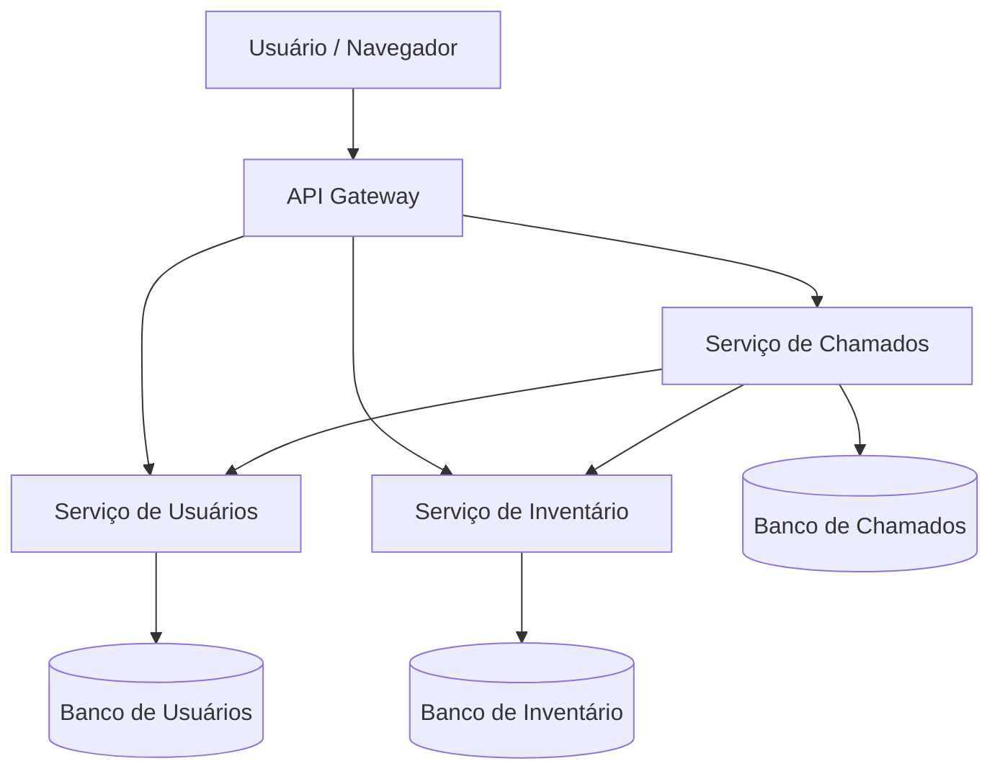

# HelpDesk TI — Arquitetura de Microsserviços

Sistema de gerenciamento de chamados de suporte técnico, desenvolvido com **Python, FastAPI, SQLite e Docker**.

Este projeto foi desenvolvido como atividade da disciplina de Arquitetura de Software. O objetivo foi migrar a aplicação original, estruturada como monólito, para uma arquitetura distribuída em microsserviços, preservando suas principais funcionalidades e regras de negócio.

## 1. Arquitetura

A aplicação foi dividida em quatro serviços independentes:

| Serviço | Responsabilidade |
|---|---|
| API Gateway | Ponto único de entrada, encaminhamento de requisições e interface web |
| Usuários | Autenticação, usuários, perfis e permissões |
| Inventário | Cadastro e consulta de equipamentos e ativos |
| Chamados | Abertura, atribuição, acompanhamento, comentários e notificações |

As notificações são gerenciadas pelo próprio serviço de Chamados. Não foi criado um microsserviço independente de notificações.

### Diagrama da arquitetura



### Comunicação entre os serviços

A comunicação entre os microsserviços ocorre por meio de APIs HTTP.

- O Gateway recebe as requisições externas e as encaminha ao serviço responsável.
- Chamados consulta Usuários para validar informações relacionadas aos usuários.
- Chamados consulta Inventário para validar os ativos associados aos chamados.
- O token JWT é encaminhado nas chamadas internas que exigem autenticação.
- As chamadas entre serviços possuem timeout e tratamento de indisponibilidade.

Cada serviço possui seu próprio banco SQLite, sem acesso direto ao banco de outro serviço.

## 2. Tecnologias utilizadas

- Python 3.12
- FastAPI
- SQLAlchemy
- SQLite
- JWT para autenticação
- Docker
- Docker Compose
- HTML, CSS e JavaScript na interface web

## 3. Estrutura do projeto

```text
helpdesk-microsservicos-pedro/
│
├── app/                       # Aplicação monolítica original
│
├── gateway/                   # API Gateway
│   ├── app/
│   └── Dockerfile
│
├── services/
│   ├── usuarios/              # Microsserviço de usuários
│   │   ├── app/
│   │   └── Dockerfile
│   │
│   ├── inventario/            # Microsserviço de inventário
│   │   ├── app/
│   │   └── Dockerfile
│   │
│   └── chamados/              # Microsserviço de chamados
│       ├── app/
│       └── Dockerfile
│
├── tests/                     # Testes da aplicação original
├── docs/                      # Imagens e documentação
├── docker-compose.yml
├── .env.example
├── README.md
└── DESAFIO.md
```

A pasta `app/` mantém a aplicação monolítica original como referência da implementação inicial.

## 4. Como executar o projeto

### Pré-requisitos

- Docker Desktop instalado e em execução.
- Git, caso queira clonar o repositório.

### Clonar o repositório

```bash
git clone https://github.com/peddrocarvalho/helpdesk-microsservicos-pedro.git
cd helpdesk-microsservicos-pedro
```

### Configurar as variáveis de ambiente

Crie o arquivo `.env` a partir do modelo:

```powershell
Copy-Item .env.example .env
```

Configure o segredo JWT no arquivo `.env`. Ele deve ser mantido privado e não deve ser enviado ao GitHub.

### Iniciar os serviços

```bash
docker compose up --build -d
```

Verificar os containers:

```bash
docker compose ps
```

A aplicação ficará disponível em:

**http://localhost:8000**

O Gateway é o único serviço que expõe uma porta para acesso externo. Os demais serviços são acessados internamente pela rede do Docker.

### Encerrar os serviços

```bash
docker compose down
```

Os volumes dos bancos de dados são preservados ao encerrar os containers com esse comando.

## 5. Funcionalidades preservadas

O sistema mantém as principais funcionalidades da aplicação original:

- Autenticação por e-mail e senha.
- Controle de acesso baseado em perfis.
- Cadastro e gerenciamento de usuários.
- Cadastro e consulta de equipamentos.
- Abertura de chamados com diferentes prioridades.
- Atribuição de chamados a técnicos.
- Atualização e acompanhamento de status.
- Comentários nos chamados.
- Cálculo de prazo de atendimento por SLA.
- Registro de notificações.
- Painel de acompanhamento dos chamados.

### Perfis de acesso

| Permissão | Solicitante | Técnico | Administrador |
|---|:---:|:---:|:---:|
| Abrir chamado | Sim | Sim | Sim |
| Consultar chamados | Próprios | Todos | Todos |
| Comentar chamados | Próprios | Todos | Todos |
| Atribuir chamados | Não | Conforme permissões | Sim |
| Gerenciar usuários | Não | Não | Sim |
| Gerenciar inventário | Não | Sim | Sim |

### Regras de SLA

| Prioridade | Prazo |
|---|---:|
| Crítica | 4 horas |
| Alta | 8 horas |
| Média | 24 horas |
| Baixa | 72 horas |

### Fluxo de status

```text
Aberto
  ↓
Em atendimento
  ↓
Resolvido
  ↓
Fechado
```

Um chamado resolvido também pode ser reaberto pelo solicitante, retornando ao atendimento.

## 6. Segurança

Foram mantidos e aplicados mecanismos de segurança para a arquitetura distribuída:

- Autenticação utilizando JWT.
- Validação de tokens nos serviços.
- Controle de permissões por perfil.
- Proteção dos endpoints que exigem autenticação.
- Encaminhamento do token nas chamadas internas.
- Configuração de segredo por variável de ambiente.
- Exposição externa somente do Gateway.
- Containers executados com usuário não privilegiado.
- Sistema de arquivos somente leitura nos containers.
- Remoção de capabilities desnecessárias.
- Opção `no-new-privileges` habilitada.

## 7. Persistência dos dados

Cada microsserviço possui seu próprio banco de dados SQLite, armazenado em um volume Docker independente.

| Volume | Banco |
|---|---|
| `usuarios_dados` | `usuarios.db` |
| `inventario_dados` | `inventario.db` |
| `chamados_dados` | `chamados.db` |

Essa separação evita o compartilhamento direto de bancos entre os serviços e permite que cada microsserviço controle seus próprios dados.

## 8. Monitoramento e tratamento de falhas

O Gateway disponibiliza o endpoint:

```http
GET /saude
```

Ele verifica a disponibilidade dos três microsserviços.

Quando todos estão disponíveis, retorna HTTP 200 e o estado `online`.

Quando algum serviço fica indisponível, retorna HTTP 503 e o estado `degradado`, identificando o serviço afetado.

As chamadas entre microsserviços também possuem timeout e tratamento de falhas de dependência.

## 9. Validações realizadas

Durante a implementação, foram realizados testes de funcionamento e integração, incluindo:

- Inicialização dos quatro containers.
- Verificação de disponibilidade dos serviços pelo Gateway.
- Acesso à interface web.
- Autenticação de diferentes perfis.
- Bloqueio de requisições sem token.
- Restrição de acesso aos chamados de outros solicitantes.
- Atribuição e atualização de chamados.
- Registro de comentários e notificações.
- Comunicação entre Chamados, Usuários e Inventário.
- Simulação de indisponibilidade de um serviço.
- Verificação do retorno HTTP 503 e recuperação após reinicialização do serviço.

Antes da migração, a aplicação monolítica original também teve sua suíte de testes automatizados executada, com **36 testes aprovados e nenhum teste reprovado**, conforme registrado no plano de migração.

## 10. Decisões e limites da implementação

A migração priorizou a separação dos domínios de usuários, inventário e chamados, com um Gateway centralizando o acesso externo.

As notificações permaneceram no serviço de Chamados, evitando a criação de um serviço adicional sem necessidade para o escopo implementado.

A comunicação entre serviços utiliza HTTP. Não foi implementado um intermediador de mensagens ou event broker.

## 11. Considerações finais

A migração permitiu transformar a aplicação original em uma arquitetura de microsserviços, com serviços executados em containers independentes, bancos de dados separados e comunicação por APIs.

O projeto demonstra conceitos de arquitetura distribuída, API Gateway, isolamento de dados, autenticação, segurança em containers, persistência e tratamento de falhas.

**Repositório:** https://github.com/peddrocarvalho/helpdesk-microsservicos-pedro
